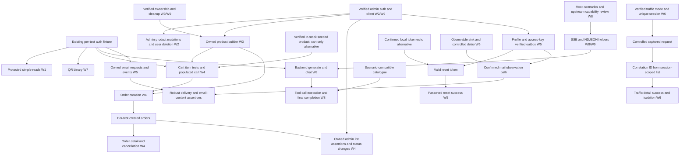

# API Test Plan History

Detailed plan archived on 7 October 2026 after simplifying the working document.
Use [api-test-plan.md](api-test-plan.md) for current next actions. The snapshot below
preserves coverage, findings and validation history; its workstream labels are historical.

This plan combines `docs/api-docs.json`, existing Playwright tests and helpers,
backend source in `../test-secure-backend`, and deterministic scenarios in
`../ollama-mock`. It defines parallel workstreams and their shared prerequisites.
The endpoint matrix tracks coverage; the iterations describe when work can start.
An endpoint used in setup is not automatically covered as an operation.

Repository review on **7 October 2026**: API tests `5187613`, backend `32eb381`,
LLM mock `9768885`. See the [source review and verification record](docs/exploration/2026-10-07-parallel-delivery.md)
and [delivery planning record](docs/implementation/parallel-api-delivery.md).
Local source evidence does not prove the deployed version or active profile.
Unconfirmed deployment behavior is explicitly marked **Needs verification**.

## Current Baseline

Already covered in `tests/api`:

| Endpoint | Auth | Status | Notes |
| --- | --- | --- | --- |
| `POST /api/v1/users/signup` | Public | Done | Public registration flow. |
| `POST /api/v1/users/signin` | Public | Done | Produces access and refresh tokens. |
| `GET /api/v1/users/me` | Bearer | Done | Confirms authenticated fixture/client setup. |
| `POST /api/v1/users/refresh`, `POST /api/v1/users/logout` | Public / Bearer | Done | Token rotation and revocation. |
| `GET /api/v1/traffic/info`, `GET /api/v1/traffic/logs` | Public (legacy mode) | Done (core) | 6 tests: info, session topics, pagination/isolation and validation. |
| `GET /api/v1/products`, `GET /api/v1/products/{id}` | Bearer | Done (core) | 6 tests: reads, validation, authentication and not-found. |
| Chat/tool prompt GET and PUT | Bearer | Done (core) | 12 tests: defaults, updates/isolation, null reset, length validation and authentication. |
| `GET /api/v1/users`, `GET /api/v1/users/{username}` | Bearer | Done (core) | 5 tests: registered profile reads, missing authentication and absent username. |
| `GET /api/v1/cart`, `DELETE /api/v1/cart` | Bearer | Done (core) | 4 tests: empty cart, populated clear and missing authentication. |
| OpenAPI smoke checks | Public | Done | `api-docs` and Swagger UI checks exist. |

Focused revision on 6 October 2026: **9/9 user/cart tests passed**; full-suite
verification passed **59/59** with two workers and zero retries.
Typechecking and `git diff --check` passed. The earlier traffic/products/prompts
batch added 24 tests and passed the then-current 50-test suite.

Current baseline on **7 October 2026**: **59/59 passed in 40.1s** against
`https://awesome.byst.re`, with two workers and zero retries using
`npm.cmd run test:api -- --workers=2 --retries=0`. Initial sandbox execution failed
at connection setup (`connect EACCES`); the subsequent network-enabled run passed
after explicit user authorization. Historical results and Done statuses remain
unchanged. `npm.cmd run typecheck` passed during this documentation review.

## Working Rules

- Keep one test file per endpoint operation.
- Same URL with different HTTP methods means separate files.
- Initialize HTTP clients in test setup, following `tests/api/users/me.spec.ts`.
- Use Given/When/Then `test.step` labels for setup, the tested action, and assertions.
- In each spec, order tests by expected response code ascending: `200`, `201`, `202`, `204`, then `400`, `401`, `403`, `404`, `409`, `422`, `429`.
- When an endpoint behavior is unclear, check `docs/api-docs.json`, backend code, or the live app before adding the test.
- Run newly created tests first. After they pass, run the whole suite to catch regressions.

Suggested file naming:

| Endpoint | File |
| --- | --- |
| `POST /api/v1/users/refresh` | `tests/api/users/refresh.spec.ts` |
| `PUT /api/v1/users/{username}` | `tests/api/users/username.put.spec.ts` |
| `DELETE /api/v1/users/{username}` | `tests/api/users/username.delete.spec.ts` |
| `GET /api/v1/products/{id}` | `tests/api/products/id.get.spec.ts` |
| `POST /api/v1/cart/items` | `tests/api/cart/items.post.spec.ts` |

## Difficulty Scale

| Difficulty | Meaning |
| --- | --- |
| 1 | Simple public or read-only endpoint; little setup; stable assertions. |
| 2 | Auth required or light setup; still mostly direct request/response checks. |
| 3 | Requires seeded data, ownership checks, role checks, or state cleanup. |
| 4 | Multi-step business flow or destructive operation. |
| 5 | Streaming, async, rate-limited, environment-sensitive, or external-service dependent. |

## Parallel Workstreams

All additions below are **planned**, not implemented. Use the existing unique
registered-user fixture unless a case needs admin privileges. Start from one main
happy path, missing auth for protected operations, and one meaningful negative
case; add role/ownership cases where they test a distinct restriction. The matrix
is a candidate inventory, not a quota requiring every listed response immediately.

Commands use `npm.cmd` on Windows because `npm.ps1` is blocked by this shell's
execution policy. On other shells use `npm`. A command naming a new spec or folder
is a future command: create the specs before running it. After each new batch
passes, run `npm.cmd run test:api -- --workers=2 --retries=0`,
`npm.cmd run typecheck`, and `git diff --check`.

### W0 — Baseline and completed regression coverage

- **Goal/endpoints:** preserve the 59 existing auth, profile, prompt, product read,
  cart read/clear, traffic and docs tests listed in Current Baseline.
- **Prerequisites:** configured `API_BASE_URL`, configured login account for signin,
  network access, and the deployment's legacy traffic mode. Registration fixture
  setup must work and an in-stock catalogue product must exist for populated clear.
- **Parallel/dependencies:** source review and typechecking can run immediately
  alongside every stream. Current live baseline is verified above; require a new
  full-suite pass after each subsequent automation batch.
- **Risks:** deployment/source drift, shared catalogue changes, rate limits and
  existing signup tests leaving created accounts behind; signup does not use the
  lifecycle fixture. Preserve coverage while W3/W9 improve cleanup.
- **First cases/additions:** rerun existing tests; inspect failures by setup versus
  endpoint behavior. No new endpoint client is required.
- **Validation:** `npm.cmd run test:api -- --workers=2 --retries=0`.

### W1 — Public and simple authenticated reads

- **Goal/endpoints:** add `GET /api/v1/users/me/email-events`,
  `GET /api/v1/ollama/chat/tools/definitions`, and empty fresh-user
  `GET /api/v1/orders` coverage; preserve already completed public/docs and other reads.
- **Prerequisites:** existing auth fixture and small typed client methods.
- **Parallel/dependencies:** can start immediately with W2, W6, W7 and helper design.
  Empty email-event/order reads need no mail sink, products or created orders;
  tool definitions come from the backend catalog and need no live model.
  Nonempty events move to W5 and order filter assertions over owned data to W4.
- **Risks:** mistaking structural reads for side-effect coverage, asserting global
  counts, or requiring a model for tool schema retrieval.
- **First cases:** `200` fresh-user event list/empty order page or supported tool
  schema; `401` missing auth. Assert tool names `list_products` and
  `get_product_snapshot` and parameter schemas; verify current deployment first.
- **Additions:** `UsersClient.getEmailEvents`, `OrdersClient.getOrders`,
  `OllamaClient.getToolDefinitions`, response types and focused shape assertions.
- **Validation:** run the selected new specs explicitly, e.g.
  `npm.cmd run test:api -- tests/api/users/email-events.get.spec.ts tests/api/orders/index.get.spec.ts tests/api/ollama/tool-definitions.get.spec.ts --workers=2 --retries=0`.

### W2 — Admin product and user management

- **Goal/endpoints:** product `POST`, `PUT /{id}`, `DELETE /{id}`;
  user `PUT /{username}`, `DELETE /{username}` and owner/admin
  `DELETE /{username}/right-to-be-forgotten`, all under `/api/v1`.
  Admin inventory endpoints are a separately staged extension listed below.
- **Prerequisites:** verified admin signin with `ROLE_ADMIN`, dedicated test-owned
  products/users, and W3 cleanup. Signup always creates `ROLE_CLIENT`; existing
  `API_LOGIN_*` settings do not establish that an admin fixture exists.
- **Parallel/dependencies:** admin fixture design and ordinary-client `403` cases
  can start now. Admin success paths wait for role verification and cleanup.
  Product CRUD can run alongside QR/email/traffic and read-only work. Owner profile
  edit and forget cases can proceed without admin once teardown tolerates deletion.
  W4 owns order admin specs but consumes this admin fixture.
- **Risks:** deleting shared users/products, conflicting edits to UsersClient,
  FK failures for referenced products, missing-user existence checks inside
  `@PreAuthorize`, and double cleanup after a successful forget/delete test.
- **First cases:** product create `201`, update `200` with GET readback, delete
  `204`; representative validation `400`, missing auth `401`, client `403`.
  User edit `200` owner/readback and peer `403`; delete `204` only a disposable user.
  Missing-user edit/forget status is **Needs verification**, not an assumed `404`.
- **Additions:** admin auth fixture/configuration, product mutation methods/types,
  user edit/admin-delete methods, deletion-aware account lifecycle.
- **Validation:** run only newly added mutation specs first with
  `npm.cmd run test:api -- <new-spec-paths> --workers=2 --retries=0`;
  then the existing product/user folders and full suite.

### W3 — Test data creation and cleanup

- **Goal/endpoints:** supply owned users/products/cart/order setup through existing
  auth/users APIs, product CRUD, cart item operations, order create/cancel and forget.
  Helpers using these endpoints do not change their coverage statuses.
- **Prerequisites:** W9 lifecycle contract; admin access for owned product creation.
  Existing catalogue discovery supports initial cart-only work after stock checks.
- **Parallel/dependencies:** design builders immediately alongside W2/W5/W8.
  Product fixture implementation waits for admin success/cleanup verification;
  order builder integration waits for populated cart setup. Publish these handoffs
  incrementally so all dependent streams need not wait for a single large fixture.
- **Risks:** checkout permanently consumes shared seeded stock, forget deletes
  orders without restoring stock, product deletion before cart/order references
  are gone, and leaking resources when setup partially succeeds.
- **First cases:** create/read/delete an owned product; prove account/cart cleanup
  on success and failure; validate a populated-cart setup before order creation.
  Record and surface teardown failures, including already-deleted account handling.
- **Additions:** product/address builders and per-test resource ownership registry.
  Teardown order: stop/finish side-effect assertions; cancel cancellable owned orders
  if stock restoration is required; clear carts/forget owned users and their orders;
  delete owned products last. Verify this chain against the actual deployment/DB.
- **Validation:** run the first new specs consuming each helper, then affected
  product/cart/order/user specs and full suite; no standalone fixture command exists.

### W4 — Cart and order business flows

- **Goal/endpoints:** cart item `POST`, `PUT /{productId}`, `DELETE /{productId}`;
  order `POST`, `GET`, `GET /{id}`, `POST /{id}/cancel`,
  `GET /admin`, `PUT /{id}/status` under `/api/v1/cart` and `/api/v1/orders`.
- **Prerequisites:** auth fixture; stock-aware product setup; populated cart and
  valid address for checkout; created per-test order for detail/cancel/status;
  verified admin fixture for admin successes and admin detail/cancellation branches.
- **Parallel/dependencies:** cart-only cases can use confirmed seeded products now
  because addition checks stock but does not reserve it. Checkout and stock-conflict
  tests should wait for owned products and cleanup. Cart item and order specs may
  be authored concurrently once builder interfaces are agreed; do not share mutable
  carts/orders between specs. Empty order reads and ordinary-user `403` on admin
  list do not require order creation.
- **Risks:** stock races, stale captured prices, source/deployment inventory drift,
  confusing peer detail `404` with peer cancellation `403`, and assuming a complete
  status transition state machine that source does not implement.
- **First cases:** item add/update/remove `200` with cart readback, `400` invalid
  quantity, `401`, relevant missing product/item `404`; zero PUT removes an item.
  Checkout `201` creates PENDING order and clears cart; empty cart `400`.
  Own detail `200`, peer detail `404`, own cancellation `200`, peer cancel `403`.
  Admin list/status `200`, missing auth `401`, client `403`; cancellation from a
  non-PENDING/non-PAID status `400`. Add stock `409` only with controlled products.
- **Additions:** cart update/remove methods, OrdersClient/types, address builder,
  product/cart/order fixtures and decimal-money assertions using captured prices.
- **Validation:** run new item specs first, then new order specs when their data gate
  is met: `npm.cmd run test:api -- <new-cart-or-order-spec-paths> --workers=2 --retries=0`.

### W5 — Password reset and email side effects

- **Goal/endpoints:** `POST /api/v1/users/password/forgot`, `/password/reset`,
  `POST /api/v1/email`, and nonempty `/users/me/email-events`; optionally inspect
  `GET /api/v1/local/email/outbox` in profiles that expose it.
- **Prerequisites:** disposable local-password user; confirmed profile/sink/token
  access and bounded polling. Outbox access requires admin and may require
  `X-Local-Outbox-Key`; local token echo is an alternative for reset, not mail proof.
- **Parallel/dependencies:** source/profile exploration, empty event reads, forgot
  contract/validation and reset invalid-token cases can start without a sink.
  Reset success waits for a valid token. Delivery/content assertions wait for an
  observable sink and suitable timing; do not block basic reads on these gates.
- **Risks:** non-test email delay is 10 seconds to 10 minutes, global outbox deletion
  interfering with another worker, credentials changed by reset, pending scheduled
  email after account teardown, rate limits and mistaken claims of inbox delivery.
- **First cases:** forgot `202` with the same generic message for known/unknown
  identifiers (token echo differs in local mode); reset `200`, new-password signin
  and old refresh token rejection; invalid token/mismatch `400`.
  Email `200` empty queued response, blank subject `400`, missing auth `401`;
  poll for owned QUEUED/eventual sink status only within a verified environment budget.
- **Additions:** password/email client methods/types, token provider selected by
  profile, recipient/template/event-ID polling and reset-aware account cleanup.
  Outbox has no per-user clear endpoint: filter by unique recipient, avoid global
  `DELETE` in parallel suites; isolate/serialize global clearing if later required.
- **Validation:** `npm.cmd run test:api -- <new-password-email-spec-paths> --workers=1 --retries=0`
  for the first side-effect spike, then two workers only after isolation is proved.

### W6 — Traffic correlation and observability

- **Goal/endpoints:** extend existing info/logs coverage with
  `GET /api/v1/traffic/logs/{correlationId}` and focused session/filter checks.
- **Prerequisites:** verify legacy-public versus protected mode; unique valid
  `X-Client-Session-Id`; controlled captured request and session-scoped list query.
  Existing `logs.get.spec.ts` already generates controlled info requests.
- **Parallel/dependencies:** can start immediately; independent of products,
  orders, email and LLM. Known ID blocks only detail `200`, not unknown-ID `404`.
  Protected mode requires auth/header extensions before its live tests.
- **Risks:** global traffic counts, retention races, capture exclusions and sensitive
  body data. The filter generates its own UUID; do not assume a caller-provided
  correlation ID or correlation response header.
- **First cases:** generate one info request with a unique session, poll its listed
  correlation ID, lookup `200` metadata; other-session lookup `404` and unknown
  UUID `404` with empty body. Auth expectations follow verified active mode.
- **Additions:** TrafficClient.getLog, optional bearer support, relevant filters and
  bounded session-scoped polling. Keep traces/raw body attachments off.
- **Validation:** `npm.cmd run test:api -- tests/api/traffic --workers=2 --retries=0`
  after the new correlation spec passes by itself.

### W7 — QR binary responses

- **Goal/endpoints:** `POST /api/v1/qr/create` PNG generation and input/auth errors.
- **Prerequisites:** existing auth fixture; client using `Accept: image/png` (the
  global default is JSON); binary assertion helper. No commerce or external LLM.
- **Parallel/dependencies:** can start immediately alongside all other streams.
  Rate-limit testing waits for controlled configuration and is separately scoped.
- **Risks:** incorrect Accept negotiation, interpreting binary as JSON, unstable
  byte snapshots, and sharing rate-limit budgets with repeated requests.
- **First cases:** `200` image/png with PNG signature and nonzero IHDR dimensions;
  optionally decode to the supplied text when a decoder is selected. Blank text
  `400` and missing auth `401` with compatible error Accept headers. Live content
  negotiation for errors is **Needs verification**.
- **Additions:** QrClient, response buffer helper and PNG structure assertion;
  no image-generation service is required.
- **Validation:** `npm.cmd run test:api -- tests/api/qr --workers=2 --retries=0`
  once new specs exist and have passed individually.

### W8 — Ollama streaming and tool calling

- **Goal/endpoints:** backend `POST /api/v1/ollama/generate`, `/chat`, `/chat/tools`;
  W1 owns simple tool-definition reads. Direct mock `/api/generate`, `/api/chat`,
  `/api/chat/tools`, `/api/chat/tools/definitions` and `/api/version` are prerequisite
  probes, not backend endpoint coverage.
- **Prerequisites:** auth; confirmed backend upstream URL/profile; deterministic
  scenario requests; separate NDJSON and SSE parsers; bounded incremental transport
  for assertions about delivery before EOF. W9 publishes the helper interface.
- **Parallel/dependencies:** helper/scenario work can start now, independently of
  admin and email. Backend generate/chat success waits for upstream reachability;
  tool execution additionally needs catalogue data matching the scenario (some
  scenarios hardcode product IDs). Definitions and malformed input/auth cases need
  no live model. Final text is deterministic only in the confirmed mock environment.
- **Risks:** loss of whitespace across chunks, confusing buffered bodies with live
  streaming, intermediate `done:true` ending a tool loop prematurely, random tool
  call IDs/timestamps, fixed catalogue assumptions and errors after HTTP commitment.
- **First cases:** generate with `Summarize the release plan`, chat with
  `Give me a quick status update on the Ollama mock`: `200` SSE, parse every JSON
  data event, assemble response/content losslessly and validate final completion.
  Start tool loop with `What Beauty products do we have available?` plus supported
  definitions; assert assistant tool call, backend `role: tool` output, then final
  assistant completion. This scenario avoids a hardcoded product snapshot ID.
  Add `400` blank model/prompt or empty messages and `401` missing auth.
- **Additions:** OllamaClient/types, SSE/NDJSON helpers, timeout/abort/disposal,
  scenario manifest and upstream capability configuration. For tools, consume to
  EOF and validate the final phase; do not stop at the first `done:true`.
  Agree a helper returning HTTP status/content type, ordered typed events and
  completion/abort diagnostics. Decode UTF-8 incrementally, retain partial frames
  across reads, parse SSE data events separately from NDJSON lines, and preserve
  whitespace inside response/content fields. Buffered body checks can prove final
  content; incremental transport is needed to prove events arrive before EOF.
  Missing-model `404` and injected upstream failures are **Needs verification** in
  a real Ollama or separate error-capable controlled upstream: this mock echoes any
  nonblank model and unsupported prompts produce successful explanatory content.
- **Validation:** `npm.cmd run test:api -- tests/api/ollama --workers=1 --retries=0`
  once new specs exist; raise concurrency only after stream completion and rate
  budgets are verified. Mock Maven tests are supporting evidence, not a substitute
  for backend API validation; neither Java repository is modified by this plan.

### W9 — Shared clients, fixtures and helpers

- **Goal/endpoints:** support W1–W8 through auth/users/products/cart/orders clients,
  lifecycle builders, mail observers, traffic correlation, binary and stream helpers.
- **Prerequisites:** reviewed interfaces and contract sources, with one maintainer
  for shared files. Existing AuthClient refresh/logout, ProductsClient reads,
  TrafficClient info/logs, CartClient read/clear/add and UsersClient profile/prompts/
  forget already exist; do not plan to recreate them.
- **Parallel/dependencies:** agree minimal interfaces immediately, then deliver
  helpers incrementally with the first consumer. Admin credentials, product setup,
  mail timing and upstream transport are independent prerequisite tracks, not one
  universal blocker. Publish interfaces before dependent agents implement callers.
- **Risks:** competing fixture/client edits, worker-shared tokens revoked by logout,
  reset or deletion, partially completed registration leaking an account, and
  central helpers expanding scope beyond selected core cases.
- **First cases/additions:** exercise each new method through its consuming spec;
  add lifecycle recovery for partial setup and tests deliberately deleting users.
  Admin fixture must never delete its configured shared admin account. Keep per-test
  accounts/products/session IDs and document helper ownership and cleanup order.
  Do not logout, reset, forget or change MFA on that shared account in fixture
  teardown; logout revokes refresh tokens across sessions. New admin credential
  settings are a planned addition, distinct from existing `API_LOGIN_*`.
- **Validation:** `npm.cmd run typecheck`; targeted consumer specs, followed by the
  full suite. Parser/lifecycle tests are justified where they verify chunk boundaries,
  whitespace, aborts or failure cleanup; avoid tests that only mirror wrappers.

## Dependency Map

Arrows are prerequisites for the named behavior, not mandatory ordering for every
negative/empty case. Product choice has two branches: verified seeded products
unblock cart-only setup; owned products unblock isolated checkout/stock assertions.

Without Mermaid rendering, read each arrow as “must be available before this
success assertion.” Email event shape/empty reads, empty order reads, tool schema
reads, unknown correlation lookup and appropriate validation/auth failures can
proceed before their nonempty success dependencies. Admin list structure needs
admin only; asserting an owned created order additionally needs ORDERS.

### Work that can start immediately versus work that waits

| Suggested owner | Start now in parallel | Wait for |
| --- | --- | --- |
| A: W2/admin | Verify role setup, product CRUD contract and client `403` cases; publish admin interface | Admin credentials/role and owned-resource cleanup for mutations |
| B: W5/email | Profile/token/sink exploration; empty events and forgot/reset-negative case design | Observable token for reset success; sink/delay for robust mail assertions |
| C: W8/LLM | Mock scenario manifest, SSE/NDJSON helper spike, simple definition reads | Reachable confirmed upstream; scenario-compatible data for tool execution |
| D: W3/W4/data | Product/address/cart/order builder interfaces; cart-only tests after stock confirmation | Owned products and teardown for checkout; created orders for detail/cancel/status |
| E: W6/W7 | Traffic detail helper using existing controlled requests; QR binary client/assertions | Verified traffic mode/correlation capture and QR error negotiation |
| W9 shared maintainer | Agree client/fixture signatures and integrate small prerequisite changes | First consuming specs and their verification before declaring helpers ready |

These are assignment boundaries, not a requirement to run six agents. With fewer
contributors, combine W1/W6/W7 and W3/W9 while keeping environment exploration
independent. Development in parallel differs from running tests in parallel:
per-test data can coexist, but global outbox clearing and rate-limit exercises
need an isolated environment or serialization.

## Recommended Delivery Order

| Iteration | Parallel actions | Exit evidence and remaining gates |
| --- | --- | --- |
| 0 — Baseline and repository understanding | W0 suite verification; backend security/service audit; mock scenario/transport review; reconcile OpenAPI, folder plans and existing helpers | Record actual suite result/blocker, source/deployment differences and environment capabilities; never replace old validation history with an assumed pass |
| 1 — Unblock delivery | W2/W9 admin fixture; W3 product builder/cleanup; W8 stream helper spike; W5 token/outbox/delay exploration; W6 mode/correlation helper | Publish independent admin, product lifecycle, stream and mail handoffs with typed interfaces and first consumer checks; mail is not a gate for QR/reads/cart |
| 2 — Independent streams | W1 simple reads; W2 isolated product/user mutations when admin gate passes; W6 traffic detail; W7 QR; W8 generate/chat when stream/upstream gate passes; W4 cart-only cases after product confirmation | Targeted new tests pass per stream, then full suite after integration; defer unresolved deployment behavior explicitly |
| 3 — Dependent commerce | W4 checkout with owned products and populated carts; then per-test order detail/cancel and admin status/list assertions | Confirm stock deduction/restoration, ownership behavior and cleanup; admin order successes require both role and relevant order setup |
| 4 — Environment-sensitive behavior | W5 reset success and delivery events; W6 detailed correlation/sanitization; W8 tool loops and upstream failures; controlled stock conflicts | Token/sink and bounded delay confirmed; final stream phase/EOF handled; explicit upstream-error capabilities; serialized global operations |
| 5 — Hardening and documentation | Targeted changed tests then complete suite; concurrency/flakiness review, typecheck, diff check; update root/folder plans and historical records | No unresolved cleanup failures; actual commands/results recorded; Done applies only to delivered cases; environment exclusions remain visible |

Iterations are dependency gates, not calendar-wide barriers. A stream can advance
as soon as its own prerequisites pass; high-risk assertions may remain blocked
while independent coverage is delivered.

### Endpoint delivery inventory

The former linear list is retained as an operation inventory for difficulty and
scope. Row numbers are references only; use the workstreams and iterations above
to schedule delivery. Completion states and earlier rationale are preserved.

| Ref | Endpoint | Difficulty | Setup / Coverage Note |
| --- | --- | ---: | --- |
| 1 | `POST /api/v1/users/refresh` | 2 | Done. Reuses existing signin flow and validates token plumbing. |
| 2 | `POST /api/v1/users/logout` | 2 | Done. Reuses auth fixture; pairs naturally with refresh token tests. |
| 3 | `GET /api/v1/traffic/info` | 1 | Done (core). Public in legacy mode; session topic and validation. |
| 4 | `GET /api/v1/traffic/logs` | 1 | Done (core). Public page structure and controlled session pagination. |
| 5 | `GET /api/v1/products` | 2 | Done (core). Authenticated read-only endpoint. |
| 6 | `GET /api/v1/products/{id}` | 2 | Done (core). Read, `400`, `401` and `404`. |
| 7 | `GET /api/v1/users/chat-system-prompt` | 2 | Done (core). Current-user default and authentication. |
| 8 | `PUT /api/v1/users/chat-system-prompt` | 2 | Done (core). Persistence/isolation, reset, length and authentication. |
| 9 | `GET /api/v1/users/tool-system-prompt` | 2 | Done (core). Same pattern as chat read. |
| 10 | `PUT /api/v1/users/tool-system-prompt` | 2 | Done (core). Same pattern as chat update; parsing/type defects remain open. |
| 11 | `GET /api/v1/users` | 2 | Done (core). 2 tests: client list and missing authentication. |
| 12 | `GET /api/v1/users/{username}` | 2 | Done (core). 3 tests: registered profile, missing authentication and `404`. |
| 13 | `GET /api/v1/cart` | 2 | Done (core). 2 tests: empty cart with zero totals and missing authentication. |
| 14 | `DELETE /api/v1/cart` | 2 | Done (core). 2 tests: populated clear and missing authentication. |
| 15 | `GET /api/v1/users/me/email-events` | 3 | Needs email/password-reset action if asserting non-empty results. |
| 16 | `POST /api/v1/users/password/forgot` | 3 | Public, but async email side effect and `202` behavior need care. |
| 17 | `POST /api/v1/users/password/reset` | 4 | Requires acquiring a valid reset token or local outbox support. |
| 18 | `POST /api/v1/products` | 3 | Admin-only mutation; needs admin client and cleanup. |
| 19 | `PUT /api/v1/products/{id}` | 3 | Admin-only mutation; needs existing product. |
| 20 | `DELETE /api/v1/products/{id}` | 3 | Admin-only destructive operation; isolate test data. |
| 21 | `POST /api/v1/cart/items` | 3 | Needs product data and quantity validation. |
| 22 | `PUT /api/v1/cart/items/{productId}` | 3 | Needs existing cart item. |
| 23 | `DELETE /api/v1/cart/items/{productId}` | 3 | Needs existing cart item and `404` coverage. |
| 24 | `PUT /api/v1/users/{username}` | 3 | Owner/admin authorization logic plus validation. |
| 25 | `DELETE /api/v1/users/{username}` | 4 | Admin-only destructive operation. |
| 26 | `DELETE /api/v1/users/{username}/right-to-be-forgotten` | 4 | Destructive owner/admin flow; may remove cart/orders/email events. |
| 27 | `POST /api/v1/orders` | 4 | Requires cart setup and address payload. |
| 28 | `GET /api/v1/orders` | 3 | Needs created or seeded orders; pagination/status filters. |
| 29 | `GET /api/v1/orders/{id}` | 3 | Ownership/admin behavior plus `404`. |
| 30 | `POST /api/v1/orders/{id}/cancel` | 4 | Status-dependent business rules. |
| 31 | `GET /api/v1/orders/admin` | 3 | Admin-only list and client `403`. |
| 32 | `PUT /api/v1/orders/{id}/status` | 4 | Admin-only status transitions and invalid transition checks. |
| 33 | `POST /api/v1/email` | 4 | Authenticated async side effect and rate limiting. |
| 34 | `POST /api/v1/qr/create` | 3 | Binary PNG response; rate limiting can be separate. |
| 35 | `GET /api/v1/traffic/logs/{correlationId}` | 3 | Needs known correlation id or controlled log creation. |
| 36 | `GET /api/v1/ollama/chat/tools/definitions` | 2 | Backend-owned schema read; no model dependency. |
| 37 | `POST /api/v1/ollama/generate` | 5 | SSE helper and confirmed upstream; helper work can start now. |
| 38 | `POST /api/v1/ollama/chat` | 5 | SSE helper, upstream and deterministic scenario if using the mock. |
| 39 | `POST /api/v1/ollama/chat/tools` | 5 | SSE plus function-calling/catalogue behavior; definitions do not wait for this. |

## Backend-Informed Notes

Security comes from `WebSecurityConfig`. Public endpoints include signin, signup, refresh, password reset and docs. Traffic endpoints are public only when legacy public access is enabled, as observed on the configured deployment. Check local email outbox authorization against the running profile. Other endpoints in the matrix require bearer authentication.

Role checks are mostly method-level:

| Endpoint Group | Backend Behavior |
| --- | --- |
| Product mutations | `POST`, `PUT`, and `DELETE /api/v1/products...` require `ROLE_ADMIN`. |
| User delete | `DELETE /api/v1/users/{username}` requires `ROLE_ADMIN`. |
| User edit | `PUT /api/v1/users/{username}` allows admin or the same username. |
| Right to be forgotten | Allows admin or the same username. |
| Order admin list/status | `GET /api/v1/orders/admin` and `PUT /api/v1/orders/{id}/status` require `ROLE_ADMIN`. |
| Traffic endpoints | Public only with legacy public access; otherwise authentication/session requirements apply. Keep tests structural and avoid brittle assumptions about logged traffic volume. |
| Ollama endpoints | Bearer auth; POST operations expose SSE over upstream JSON/NDJSON. Definitions are local read-only data. Explore helpers early; gate success tests on upstream capabilities. |

Important implementation detail: some user endpoints combine existence checks inside `@PreAuthorize`, for example `PUT /api/v1/users/{username}` and `DELETE /api/v1/users/{username}/right-to-be-forgotten`. If a user does not exist, Spring Security may return `403` before controller logic can produce the documented `404`. Verify against the live app before locking expected status codes.

Auth coverage uses a unique registered account per test and fixture-owned cleanup.
Refresh covers usable access tokens, replacement-token rotation, missing/blank
input (`400`), unknown/access/consumed tokens (`401`), and stale Bearer headers
(`401`). Logout covers an empty `200` response, revocation across multiple
sessions, a usable new session after sign-in, and missing/malformed authorization
(`401`). Both specs use `test.step` and disable traces and retries.

Live observation on 5 October 2026 at `https://awesome.byst.re`: replaying a
consumed refresh token returns `401`, but its replacement still refreshes with
`200`. The local backend source additionally revokes the token family on replay.
That source/deployment difference needs follow-up; family revocation is not an
assertion in the current suite because the published contract specifies rotation
and invalid-token rejection without promising family revocation. Access JWTs
remain usable after logout, so fixture cleanup can use the original JWT.

### Findings that affect dependencies

The following behavior is established in inspected source, not newly observed on
the deployment. Source paths and reproduction prerequisites are recorded in the
[7 October review](docs/exploration/2026-10-07-parallel-delivery.md).

| Area | Source evidence and planning implication |
| --- | --- |
| Admin and auth | Signup assigns ROLE_CLIENT. Bootstrap code creates an admin, but does not prove usable deployed credentials. Signin can return an MFA challenge if MFA is enabled; admin fixture must verify a usable token and role, not assume every configured account is suitable. |
| Products and data | Creation requires a 3–100 character name, nonblank description/category, price >= 0.01 with <= 2 decimal places and <= 8 integer digits, nonnegative stock. Update applies supplied non-null fields; empty description/image URL are allowed. Seed catalogue comes from `bootstrap/products.json` when `app.seed-demo-data.enabled=true` outside the test profile. SetupOrders creates shared demo orders/carts, not disposable test fixtures; discover data rather than assume seed IDs/statuses exist. |
| Cart | POST adds to an existing quantity and captures current product price; quantity must be >= 1. PUT sets quantity; zero removes an item, negative is invalid. Add/update checks availability without stock deduction; insufficient stock is `409`. Dedicated item coverage remains unstarted. |
| Checkout | Address requires street/city/state/zipCode/country. Checkout locks stock, creates PENDING order with captured cart prices and clears cart; empty cart `400`, stock shortage `409`. Seeded stock is a read/cart-only option, not an isolated checkout fixture. |
| Order authorization/status | Peer detail lookup returns `404`; peer cancellation returns `403`. Admin can read/cancel any order. Cancellation is allowed only from PENDING or PAID and restores deducted stock. Admin non-CANCELLED statuses are assigned directly; do not invent other forbidden transition rules. |
| Cleanup | Forget removes refresh/reset tokens, events, carts, orders and MFA data. It does not call inventory restoration. Referenced products cannot safely be deleted before carts/orders are removed. Verify actual cleanup with inventory movements/FKs in the target DB/profile before enabling checkout in parallel. |
| Password and outbox | Forgot is public `202`; reset returns empty `200`, changes password and revokes refresh tokens. Local exposes a token; aitesters/docker configurations disable echo. Outbox exists only in local/aitesters, requires admin and in aitesters an access key. A raw valid token is not obtainable from hashed DB storage or email-event metadata. |
| Email timing | EmailService records QUEUED before scheduling send; non-test RandomDelayGenerator waits 10 seconds to 10 minutes. Events are latest 20 for the current user; SENT_TO_SMTP_SINK represents configured sink handoff, including the local stub, not external mailbox receipt. Token echo can unblock reset success without waiting for outbox delivery. |
| Traffic | Default legacy-public is false, server profile enables it. Correlation IDs are generated server-side; find them through a uniquely session-scoped list. Log reads are excluded from capture, and streaming/MFA paths have exclusions. Detailed protected-mode behavior is Needs verification on the target deployment. |
| QR | Controller produces image/png; suite globally sends Accept: application/json. QrClient must choose an appropriate Accept header and verify actual error negotiation. Assert image structure/content instead of identical encoded bytes. |
| Mock transport and models | Mock controllers emit application/x-ndjson by default and JSON for stream:false. Backend emits text/event-stream; generate forces upstream stream:true. Source default model is qwen3.5:2b; supplied nonblank models are echoed, with no missing-model failure simulation. Direct mock chat permits omitted model, but mock generate DTO requires it despite README's generic omission claim; backend generate/chat also require it. Mock property token delay is 50ms despite README saying 150ms; inspect configuration. |
| Tool completion | Backend posts tool-enabled history to mock /api/chat, injects the user's system prompts, executes supported product tools and feeds results back (default maximum 8 iterations). Each upstream iteration can include done:true before backend tool events and later assistant completion. Consume through EOF and inspect phase ordering. Mock scenarios use matching user prompt/latest user or tool role, not system-prompt semantics; generated IDs/timestamps and live tool payloads vary. Canned assistant prose does not prove real model grounding or prompt effectiveness. |

**Needs verification before implementation:** deployed admin role/MFA state,
profile/outbox key access, available sink and delay control, stock/FK cleanup,
Ollama upstream type/version, missing-model/error injection support, QR negotiation,
and missing-user edit/forget responses. These gates remain open even when the
existing baseline passes. Known prompt parsing/type defects and refresh-family
source/deployment divergence remain recorded rather than normalized into assertions.

## Endpoint Matrix

### Exploration and automation of eight operations

Exploratory checks completed on 6 October 2026 against `https://awesome.byst.re`.
All eight happy paths worked. Both prompt PUT endpoints returned unexpected
`401` for malformed JSON, object-valued fields and missing bodies with valid JWTs,
and accepted numeric fields as strings with `200`. These remain open defects.

Prompt resets, persistence and isolation worked; PUT echoes the stored reset
value while GET returns the default. Traffic topics/log selection depend on
session headers, and page sizes clamp to the configured maximum.

Findings: [exploration](docs/exploration/2026-10-06-traffic-products-prompts.md) and
[bug report](docs/prompt-bug-report.md). Coverage details:
[traffic](tests/api/traffic/api-test-plan.md),
[products](tests/api/products/api-test-plan.md), and
[users](tests/api/users/api-test-plan.md). Eight specs implement the agreed
24-test core scope; all targeted batches passed, then the full suite passed 50/50.

| Area | Endpoint | Auth | Role | Difficulty | Status | First Useful Coverage |
| --- | --- | --- | --- | ---: | --- | --- |
| Auth | `POST /api/v1/users/signup` | Public | n/a | 2 | Done | `201`, `400` validation, duplicate username/email. |
| Auth | `POST /api/v1/users/signin` | Public | n/a | 2 | Done | `200`, invalid credentials, validation. |
| Auth | `POST /api/v1/users/refresh` | Public | n/a | 2 | Done | `200`, `400`, invalid/reused refresh token. |
| Auth | `POST /api/v1/users/logout` | Bearer | Any | 2 | Done | `200`, `401`, refresh token no longer usable. |
| Users | `GET /api/v1/users/me` | Bearer | Any | 2 | Done | `200`, `401`. |
| Users | `GET /api/v1/users` | Bearer | Any | 2 | Done (core) | 2 tests: `200` array with registered profile; `401` missing auth. |
| Users | `GET /api/v1/users/{username}` | Bearer | Any | 2 | Done (core) | 3 tests: `200` registered profile, `401` missing auth, `404` absent username. |
| Users | `PUT /api/v1/users/{username}` | Bearer | Owner/Admin | 3 | Not started | `200`, `400`, `401`, `403`, verified missing-user behavior. |
| Users | `DELETE /api/v1/users/{username}` | Bearer | Admin | 4 | Not started | `204`, `401`, `403`, `404`. |
| Users | `DELETE /api/v1/users/{username}/right-to-be-forgotten` | Bearer | Owner/Admin | 4 | Not started | `204`, `401`, `403`, verified missing-user behavior. |
| Prompts | `GET /api/v1/users/chat-system-prompt` | Bearer | Any | 2 | Done (core) | 2 tests: `200` default, `401` missing auth. |
| Prompts | `PUT /api/v1/users/chat-system-prompt` | Bearer | Any | 2 | Done (core); defects open | 4 tests: `200` persistence/isolation and null reset, `400` length, `401` auth. |
| Prompts | `GET /api/v1/users/tool-system-prompt` | Bearer | Any | 2 | Done (core) | 2 tests: `200` default, `401` missing auth. |
| Prompts | `PUT /api/v1/users/tool-system-prompt` | Bearer | Any | 2 | Done (core); defects open | 4 tests: `200` persistence/isolation and null reset, `400` length, `401` auth. |
| Password | `POST /api/v1/users/password/forgot` | Public | n/a | 3 | Not started | `202`, validation, no user enumeration. |
| Password | `POST /api/v1/users/password/reset` | Public | n/a | 4 | Not started | `200`, invalid token, password mismatch/validation. |
| Products | `GET /api/v1/products` | Bearer | Any | 2 | Done (core) | 2 tests: `200` array shape, `401`. |
| Products | `GET /api/v1/products/{id}` | Bearer | Any | 2 | Done (core) | 4 tests: `200`, `400` nonnumeric ID, `401`, `404`. |
| Products | `POST /api/v1/products` | Bearer | Admin | 3 | Not started | `201`, `400`, `401`, `403`. |
| Products | `PUT /api/v1/products/{id}` | Bearer | Admin | 3 | Not started | `200`, `400`, `401`, `403`, `404`. |
| Products | `DELETE /api/v1/products/{id}` | Bearer | Admin | 3 | Not started | `204`, `401`, `403`, `404`. |
| Cart | `GET /api/v1/cart` | Bearer | Any | 2 | Done (core) | 2 tests: `200` empty cart/zero totals; `401` missing auth. |
| Cart | `DELETE /api/v1/cart` | Bearer | Any | 2 | Done (core) | 2 tests: `204` populated clear verified by GET; `401` missing auth. |
| Cart | `POST /api/v1/cart/items` | Bearer | Any | 3 | Not started | `200`, `400`, `401`, `404`. |
| Cart | `PUT /api/v1/cart/items/{productId}` | Bearer | Any | 3 | Not started | `200`, `400`, `401`, `404`. |
| Cart | `DELETE /api/v1/cart/items/{productId}` | Bearer | Any | 3 | Not started | `200`, `401`, `404`. |
| Orders | `POST /api/v1/orders` | Bearer | Any | 4 | Not started | `201`, `400`, `401`. |
| Orders | `GET /api/v1/orders` | Bearer | Any | 3 | Not started | `200`, `401`, pagination/status filter shape. |
| Orders | `GET /api/v1/orders/{id}` | Bearer | Owner/Admin | 3 | Not started | `200`, `401`, `404`, ownership behavior. |
| Orders | `POST /api/v1/orders/{id}/cancel` | Bearer | Owner/Admin | 4 | Not started | `200`, `400`, `401`, `404`. |
| Orders | `GET /api/v1/orders/admin` | Bearer | Admin | 3 | Not started | `200`, `401`, `403`. |
| Orders | `PUT /api/v1/orders/{id}/status` | Bearer | Admin | 4 | Not started | `200`, `400`, `401`, `403`, `404`. |
| Email | `POST /api/v1/email` | Bearer | Any | 4 | Not started | `200`, `400`, `401`; side effect only if stable. |
| Email | `GET /api/v1/users/me/email-events` | Bearer | Any | 3 | Not started | `200`, `401`, events isolated to current user. |
| QR | `POST /api/v1/qr/create` | Bearer | Any | 3 | Not started | `200` with `image/png`, `400`, `401`. |
| Traffic | `GET /api/v1/traffic/info` | Public (legacy mode) | n/a | 1 | Done (core) | 3 tests: `200` default/session topic, `400` invalid session. |
| Traffic | `GET /api/v1/traffic/logs` | Public (legacy mode) | n/a | 1 | Done (core) | 3 tests: `200` public structure and session pagination/isolation, `400` negative page. |
| Traffic | `GET /api/v1/traffic/logs/{correlationId}` | Public (legacy mode) / Bearer | Mode-dependent | 3 | Not started | `200` controlled listed id, `404` unknown/other-session id; verify mode/session requirements. |
| Ollama | `GET /api/v1/ollama/chat/tools/definitions` | Bearer | Any | 2 | Not started | `200`, `401`, schema shape. |
| Ollama | `POST /api/v1/ollama/generate` | Bearer | Any | 5 | Not started | `200` SSE, `400`, `401`; model `404` needs an upstream that supports it. |
| Ollama | `POST /api/v1/ollama/chat` | Bearer | Any | 5 | Not started | `200` SSE, `400`, `401`; model `404` needs an upstream that supports it. |
| Ollama | `POST /api/v1/ollama/chat/tools` | Bearer | Any | 5 | Not started | `200` stream, `400`, `401`, tool behavior. |

### Additional API gaps found during reconciliation

The original matrix did not cover all operations in the saved OpenAPI/current
backend. Keep these visible without treating their prerequisites as completed:

| Group | Operations | Delivery decision |
| --- | --- | --- |
| Admin inventory | `GET /api/v1/admin/inventory`, `GET /{productId}`, `GET /{productId}/movements`, `POST /{productId}/adjustments` under that prefix | Not started; staged W2/W3 extension. Admin list shape can proceed after admin auth; item/movement/adjustment assertions require owned products. Source supports idempotent requestId replay (`201`) and conflicting payload reuse (`409`); live verification required. |
| MFA | `GET /api/v1/users/2fa/status`; `POST /api/v1/users/2fa/setup`, `/confirm`, `/disable`, `/recovery-codes`; `POST /api/v1/users/signin/2fa` | Not started; separate future authentication workstream requiring TOTP/recovery lifecycle design. Do not change the shared admin account's MFA state to unblock this plan. |
| SSO | `POST /api/v1/users/sso/exchange` | Not started; separately scope identity-provider configuration/token setup and ownership cleanup. |
| Local outbox | `GET`, `DELETE /api/v1/local/email/outbox` | W5 support operations from source, profile-dependent and absent from saved OpenAPI. Verify availability; avoid parallel global clearing. |

GraphQL/gRPC source exists but is outside this REST delivery update. MFA/SSO
dependencies have not been fully explored; they are backlog gaps, not ready-to-run
cases. Create their endpoint folder plans when their implementation is scoped.

## Suggested Client/Fixture Growth

| Owner | Existing reusable code | Missing additions and handoff |
| --- | --- | --- |
| W9/auth, W2 | AuthClient signup/signin/refresh/logout; authenticatedUser/authenticatedPeer fixtures | Verified admin configuration/auth fixture; partial-setup and deliberate-deletion lifecycle; do not reuse mutation-test tokens globally |
| W1/W2 | UsersClient profile/prompt/forget; ProductsClient read methods | User edit/admin delete/email-events; product mutation methods/types owned by W2 |
| W3/W4 | CartClient getCart/clearCart/addItem; cart assertions | update/remove item, OrdersClient and types, product/address/cart/order builders and cleanup |
| W5 | Unique registration generator and auth lifecycle | Password/email methods, profile-specific token provider, recipient-scoped outbox/sink polling and reset cleanup |
| W6 | TrafficClient getInfo/getLogs, controlled-session traffic spec | getLog, bearer support and filters; derive correlation from controlled list |
| W7 | APIRequestContext and common status assertions | QrClient, PNG buffer/signature/dimension assertions and Accept policy |
| W8/W9 | Backend/mock DTOs and deterministic scenario files as contract sources | OllamaClient/types; separate SSE/NDJSON parsers, incremental transport, EOF/phase handling, timeout/abort and disposal |

Keep request contexts scoped to the test. Assign a single owner to each shared
file and communicate signatures before parallel consumers start. Folder plans
link here for shared gates; each implementation batch records its own selected
cases, first successful run and cleanup evidence.

## Definition of Done

An endpoint is done when:

- A dedicated spec file exists for that operation.
- HTTP clients are initialized in setup.
- Tests use Given/When/Then `test.step` labels.
- Response-code order is ascending inside the file.
- Happy path and the main negative path are covered.
- `401` is covered for protected endpoints.
- `403` is covered for role/ownership restrictions.
- Status code and key response body/content are asserted.
- Newly added tests pass on their own.
- The full suite passes after the new tests pass.
- Cleanup passes on success and failure; shared seeded resources are not mutated.
- Root and affected folder plans reflect delivered/deferred coverage and actual validation.
- Environment-specific exclusions and unresolved behavior remain explicit.

## Completed Batches and Remaining Scope

Operations 11-14 now contain **9 focused tests** (user list 2, username lookup 3,
cart GET 2, cart DELETE 2), reduced from 16. Targeted verification passed **9/9**
on 6 October 2026; the full suite passed **59/59** with two workers and zero retries.
Typechecking and `git diff --check` passed.
Clients initialize in setup; specs use test.step, ascending status groups,
disabled traces and zero retries. Fixtures own account and cart cleanup.
Only populated clearing needs a catalogue product with at least one unit in stock.

Deferred: peer reads/cart isolation, populated cart GET totals, repeated empty
clearing and extra JWT variants. Shared authentication variants remain covered
by existing auth/me tests. Dedicated cart item operations remain unstarted.
Traffic secondary boundaries and prompt parsing/type defects remain deferred
in their folder plans.

See [exploration](docs/exploration/2026-10-06-users-cart.md),
[users plan](tests/api/users/api-test-plan.md), and
[cart plan](tests/api/cart/api-test-plan.md).
These operations remain complete; there is no single mandatory next endpoint.
Use the independent starts and prerequisite gates below.

## Practical Next Step

1. The 59-test baseline gate is satisfied on 7 October 2026. After automation
   changes, rerun `npm.cmd run test:api -- --workers=2 --retries=0` and record the
   actual result/environment. Preserve earlier history if subsequent live verification
   is blocked; do not mark an unexecuted rerun as passed.
2. In W2/W9, verify admin credentials and role/MFA behavior without assuming
   `API_LOGIN_*` is admin. Publish the admin fixture interface and recheck method-level
   role/existence rules for product/user/order mutations against source and deployment.
3. In parallel, W8 designs the SSE/NDJSON helper using the reviewed mock scenarios;
   W5 establishes active profile, token access, outbox admin/key access and email
   delay/sink. These explorations do not block QR or simple authenticated reads.
4. W3/W4 chooses data by use: discovered in-stock seeds for isolated cart-only setup;
   admin-created per-test products for checkout/stock assertions. Prove cleanup and
   publish product/address/cart/order builder contracts before commerce integration.
5. W1 can add empty email-event/order and tool-definition reads; W6 can derive
   correlation IDs from controlled session traffic; W7 can add binary QR coverage.
   Each needs its own first live probe before final response assertions are fixed.
6. Assign separate owners for W2, W5, W8 and W3/W4; combine W1/W6/W7 as capacity
   allows. W9 coordinates shared-file changes. Only release a dependent success
   case when its named prerequisite is verified; keep other streams moving.
7. For each implementation batch: record focused cases in `docs/implementation/`,
   run new tests first, then the full suite, typecheck and diff check. Update the
   root and affected folder plans with actual outcomes; do not count helper setup
   requests as completed endpoint coverage.
