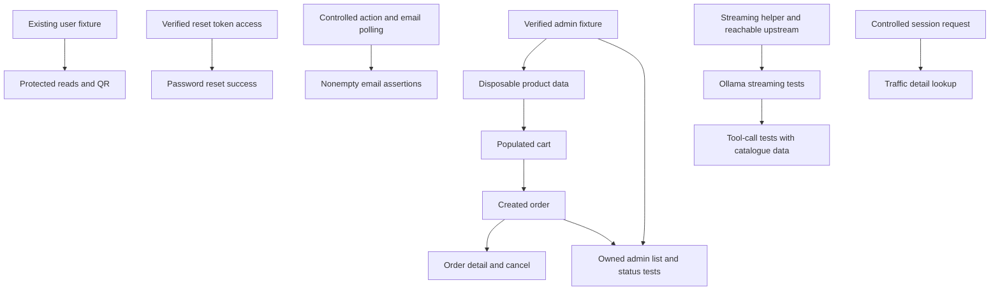

# API Test Plan

Keep this single working plan short and action-oriented. Do not create separate folder plans.
Detailed coverage and validation history live in [api-test-plan-history.md](api-test-plan-history.md).
Backend/mock findings live in the [repository review](docs/exploration/2026-10-07-parallel-delivery.md).

## Baseline

Already Done (core coverage):

- Auth: signup, signin, refresh, logout.
- Users: me, list, detail.
- Prompts: chat and tool prompt get/update; known parsing/type defects remain open.
- Products: list, detail.
- Cart: get, clear. Item POST is setup only, not dedicated coverage.
- Traffic: info, paginated logs in legacy public mode.
- OpenAPI: docs and Swagger UI smoke checks.

Latest validation: **59/59 passed on 7 October 2026**, two workers, zero retries.
QR tests are not implemented yet.

Before new coverage, confirm the baseline:

```powershell
npm.cmd run test:api -- --workers=2 --retries=0
```

## How To Split The Work

Use two main threads. Agree shared client/fixture changes before editing the same files.

### Thread A: Non-Admin

Can start with the existing `authenticatedUser` fixture.

Do next:

1. `GET /api/v1/users/me/email-events` - empty list and missing auth.
2. `GET /api/v1/ollama/chat/tools/definitions` - schema and missing auth.
3. `GET /api/v1/traffic/logs/{correlationId}` - controlled lookup and unknown ID.
4. `POST /api/v1/qr/create` - PNG, blank text, missing auth.
5. Explore password `forgot` and `reset`, plus `POST /api/v1/email` side effects.
6. Spike a streaming helper for Ollama `generate`, `chat` and `chat/tools`.

Once product data and cleanup are ready:

1. Cart item add, update and remove.
2. Order create and list.
3. Order detail and cancel using a created-order helper.

Empty order-list coverage can start earlier without product data.

### Thread B: Admin

Start by verifying admin login for the active backend profile.

Do next:

1. Verify sign-in returns a usable token with `ROLE_ADMIN`.
2. Add an admin fixture and product mutation client methods.
3. `POST /api/v1/products`.
4. `PUT /api/v1/products/{id}`.
5. `DELETE /api/v1/products/{id}`.
6. Provide disposable product setup and cleanup for Thread A.

Then continue:

1. `PUT /api/v1/users/{username}` - owner/admin/forbidden cases.
2. `DELETE /api/v1/users/{username}` and dedicated right-to-be-forgotten coverage.
3. `GET /api/v1/orders/admin`.
4. `PUT /api/v1/orders/{id}/status`.

Owner edit/forget cases do not need admin, but need deletion-aware cleanup.

## Blocked Until

| Work | Needs |
| --- | --- |
| Admin success paths | Verified admin fixture/client. Signup only creates clients. |
| Cart item success paths | Confirmed in-stock product data. |
| Checkout and stock assertions | Disposable products, populated cart, valid address and cleanup. |
| Order detail/cancel/status and owned admin-list assertions | Created-order helper; admin fixture for admin cases. |
| Password reset success | Valid token from verified local echo or observable email/outbox. |
| Nonempty/delivery email assertions | Controlled email action and bounded event/sink polling. Empty reads can start now. |
| Ollama streaming/tool success | Streaming collector and reachable upstream; catalogue data for product tools. |
| Traffic detail success | Captured request with unique `X-Client-Session-Id`, then its listed correlation ID. |

## Shared Decisions

- Products: use discovered seeds for cart-only setup; prefer disposable admin-created products for checkout. Never mutate shared seeds.
- Cleanup: own every created resource. Remove carts/orders before products; forgetting a user does not restore stock. Handle partial setup and already-deleted users.
- Admin: never reset, delete, logout or change MFA on the shared admin account during teardown.
- Email/reset: verify token and sink access first. Outbox requires admin and may require a key; do not clear it globally during parallel tests. Email-event metadata does not contain reset tokens.
- Ollama: separate backend SSE from mock NDJSON; preserve whitespace and consume tool streams through EOF, not the first `done:true`. Model `404` needs another verified upstream; this mock echoes supplied models.
- Traffic: generate a unique-session request, then find its correlation ID through `/traffic/logs`.

## Delivery Order

1. Confirm baseline.
2. Start Thread A reads/QR/exploration and Thread B admin setup in parallel.
3. Thread B provides product setup and cleanup.
4. Thread A adds cart item tests, then checkout.
5. Created orders unblock detail/cancel and admin status assertions.
6. Finish password reset, email side effects and streaming/tool cases when their prerequisites are verified.
7. Run each new batch first, then the full suite and static checks.

## Test Rules

- One spec per endpoint operation; different HTTP methods use separate files.
- Initialize HTTP clients in `test.beforeEach` or fixture setup.
- Use Given/When/Then `test.step` labels.
- Order cases by response code ascending: `200`, `201`, `202`, `204`, then `400`, `401`, `403`, `404`, `409`, `422`, `429`.
- Start with a happy path, missing auth and one meaningful negative case; add role/ownership cases where needed.
- Check `docs/api-docs.json`, backend code and live behavior when unsure. Mark unresolved behavior **Needs verification**.
- Run new tests first. After they pass, run the whole suite, `npm.cmd run typecheck` and `git diff --check`.
- Update this root plan; setup requests do not count as completed coverage.

## Backend Facts To Remember

- Public: signup, signin, refresh, password forgot/reset and docs. Traffic is public only in legacy mode; local outbox requires admin.
- Product mutations, user deletion and admin order list/status require `ROLE_ADMIN`.
- User edit/right-to-be-forgotten allow owner or admin. Missing-user behavior is **Needs verification**.
- Cart add checks stock without reserving it; checkout deducts stock and clears the cart. Cancellation is allowed from `PENDING` or `PAID` and restores deducted stock.
- QR returns `image/png`; use compatible Accept headers and verify error negotiation.
- Backend Ollama returns `text/event-stream`; the mock streams deterministic NDJSON.
- Email send delay can be 10 seconds to 10 minutes; verify timing before choosing polling limits.

Inventory, MFA and SSO coverage are later backlog items; details remain in the history file.

## Dependency Map


