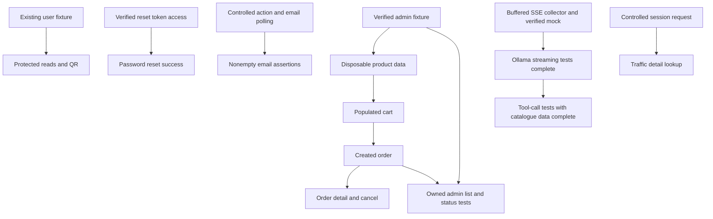

# API Test Plan

Keep this single working plan short and action-oriented. Do not create separate folder plans.
Detailed coverage and validation history live in [api-test-plan-history.md](api-test-plan-history.md).
Backend/mock findings live in the [repository review](docs/exploration/2026-10-07-parallel-delivery.md).

Ollama completed: [11 October live exploration](docs/exploration/2026-10-11-ollama.md),
[11 API tests delivered](docs/implementation/ollama-streaming-tests.md).
Known limitation: [mock final answer disagrees with catalogue](docs/ollama-mock-bug-report.md).

Ollama readability refactor: setup and stream collection moved to
`support/ollama.helpers.ts`; answer/error assertions and product-tool checks live
in `support/assertions/ollama.ts` and `support/assertions/ollama-tools.ts`.
The 11 cases and their assertion scope are retained. Validation completed.

## Cart items on staging

[20 October exploration](docs/exploration/2026-10-20-cart-items.md) confirmed the
requested scope without contract discrepancies. [Implementation record](docs/implementation/cart-item-tests.md):
11 delivered admin-project cases, POST/PUT 200/400/401/409 and DELETE 200/401/404, with
persisted state checks, isolated staging users/products and cart-first cleanup.
Focused run **11/11 passed** (21.0s); temporary assertion/partial-setup cleanup
probes **2/2 passed**. Combined regression, including parallel QR/traffic changes:
**108 passed, 1 failed** (1.6m, four workers, zero retries); all **34 admin tests**
passed. Sole failure: the documented [traffic detail 500](docs/traffic-detail-bug-report.md).
Typecheck passed. `git diff --check` failed only on pre-existing `agents.md`
whitespace at lines 7/8; cart-scope checks passed. No cart defects found.
Repeated add/combined-stock, PUT zero, additional boundaries and concurrency
remain deferred. Future order coverage can build on these owned populated carts;
no orders are added here.

## Baseline

Product/user CRUD extension implemented: [live staging evidence](docs/exploration/2026-10-13-products-users-crud.md)
and [implementation record](docs/implementation/products-users-crud-gaps.md). Seventeen
new cases passed 17/17 on 13 October 2026 (22.4s, four workers, zero retries).
Full api/admin regression passed 93/93 (1.2m, four workers, zero retries).
Typechecking and `git diff --check` passed. All new cases use disposable staging data,
with same-environment users/tokens and deletion-aware user teardown.

| Staging operation | Delivered coverage |
| --- | --- |
| Product POST | 201, invalid payload 400, missing auth 401, client 403 |
| Product PUT | 200, invalid payload 400, missing auth 401, client 403, absent ID 404 |
| Product DELETE | 204, missing auth 401, client 403, absent ID 404 (empty body) |
| User PUT | Owner/admin 200, invalid payload 400, missing auth 401, peer client 403 |
| User DELETE | Admin 204, missing auth 401, client including owner 403, absent username 404 |

Successful updates are read back; rejected updates/deletions preserve targets.
No defects observed in this requested scope. Missing-user PUT and dedicated
right-to-be-forgotten scenarios remain deferred outside this delivery.

Already Done (core coverage):

- Auth: signup, signin, refresh, logout.
- Users: me, list, detail; staging owner/admin edit, validation/auth/ownership
  rejection, admin deletion and deletion auth/role/not-found cases.
- Prompts: chat and tool prompt get/update; known parsing/type defects remain open.
- Products: list, detail; admin create, partial update and delete on staging,
  mutation validation/auth/role checks and update/delete not-found cases.
- Cart: get/clear on awesome; dedicated staging item POST/PUT/DELETE coverage,
  including persisted state, quantity validation, missing auth, stock conflicts
  and absent-item deletion (see cart delivery above).
- Traffic: info, paginated logs and detail unknown-ID 404 in legacy public mode;
  controlled detail 200 regression implemented but failing on a live 500.
- QR: PNG 200, blank text 400 and missing authentication 401.
- OpenAPI: docs and Swagger UI smoke checks.
- Ollama: tool definitions, generate, chat and chat/tools; multiline SSE events,
  whitespace, tool results and completion through EOF; 200/400/401 core cases.

Baseline before the 20 October extensions: **93 API tests**: 70 tests on awesome (`api`) and 23
admin tests on aitesters (`admin`), including **11 Ollama tests**. Standalone SSE
parser tests and the three additional auth-fixture tests were removed at the
user's request.
Previous validation after report/configuration fixes: **76/76 passed on 12 October 2026**,
48.8s, four workers, zero retries, both environments. Admin batch: **6/6 passed**, 6.5s.
Two temporary report probes passed; decoded HTML, JSON and result artifacts
contained no placeholder token. Discovery without dotenv/credentials/URL variables
passed independently (70 api / six admin). No permanent API tests were added.
Product setup/cleanup is local to specs; only the admin authentication fixture
remains in the admin infrastructure. A temporary assertion failure confirmed
`afterEach` cleanup; the original test was restored. The earlier focused overlap
run passed **9/9** and measured cross-project/concurrent-admin execution.
See the admin implementation record for details.
The prior Ollama readability refactor passed **70/70 on 11 October 2026**,
54.8s, two workers, zero retries, `https://awesome.byst.re`.
Last Ollama batch: **11/11 passed on 11 October 2026**, 16.1s, two workers,
zero retries, `https://awesome.byst.re`.
Typecheck and staged/unstaged `git diff --check` passed.
Original delivery results remain in the implementation record.
Review follow-up completed: model-phase completion, thinking/content ordering,
tool-call roles, exact mock prose, separate scenario data, and fixture setup
cleanup. Catalogue checks cover identity and payload validity; exact mutable
price/stock/availability equality requires isolated data and remains deferred.

## QR and traffic details (20 October 2026)

Live exploration completed on awesome (`api`): [QR](docs/exploration/2026-10-20-qr-create.md)
and [traffic details](docs/exploration/2026-10-20-traffic-details.md).
Added five tests: three QR cases (PNG 200, blank text 400, missing auth 401) and two traffic
detail cases (own captured request 200, unknown UUID empty 404), using unique
sessions and bounded capture polling. Separate implementation records:
[QR](docs/implementation/qr-create-tests.md), [traffic](docs/implementation/traffic-detail-tests.md).

The QR client uses `Accept: image/png, application/json` for success and errors;
[JSON-only Accept misleadingly returns 401](docs/qr-accept-bug-report.md).
Traffic remains public in legacy mode. [Found detail returns 500](docs/traffic-detail-bug-report.md),
including with authentication; retain the intended 200 assertion and report its
failure. No staging/cart clients or shared fixtures/configuration were changed.
Focused run: **4 passed, 1 failed** (3.6s, two workers, zero retries), specifically
the detail 200 assertion received 500. QR fixture teardown passed. Full suite
**not run**: the requested new-tests-pass gate is blocked by the application defect.
`npm.cmd run typecheck` passed. Repository-wide `git diff --check` failed on
pre-existing `agents.md` whitespace (lines 7 and 8); scope-only tracked diff and
new-file whitespace checks passed. Deferred: QR decoding/limits/rate limits,
automated incompatible Accept, secured traffic mode and additional detail variants.
Detail body assertions await a successful backend response.

Before new coverage, confirm the combined baseline:

```powershell
npm.cmd test -- --project=api --project=admin --workers=4 --retries=0
```

## How To Split The Work

Use two main threads. Agree shared client/fixture changes before editing the same files.

### Thread A: Non-Admin

Can start with the existing `authenticatedUser` fixture.

Do next:

1. `GET /api/v1/users/me/email-events` - empty list and missing auth.
2. Traffic detail tests are implemented; fix the backend's found-entry 500,
   then rerun the focused batch and full regression (see records above).
3. QR core coverage is implemented and passed; extended cases remain deferred.
4. Explore password `forgot` and `reset`, plus `POST /api/v1/email` side effects.

Ollama core coverage is complete for the verified mock. Real upstream errors,
model 404, rate limits, iteration caps, system-prompt behavior and incremental
flush timing remain deferred; buffered SSE tests do not measure token latency.

Product client methods and test-local setup/cleanup are ready on **aitesters**.
Future scenarios using admin-created products must run in the staging project and create their users/carts there;
the existing non-admin suite remains on awesome. Do next after staging setup:

1. Cart item add, update and remove — delivered in the staging batch above.
2. Order create and list.
3. Order detail and cancel using a created-order helper.

Empty order-list coverage can start earlier without product data.

### Thread B: Admin

Core infrastructure and examples are delivered:
[12 October exploration](docs/exploration/2026-10-12-admin-products.md),
[implementation record](docs/implementation/admin-environments-and-disposable-products.md).

- Separate `api`/`admin` projects with disjoint file filters and environment routing.
- Test-scoped admin sign-in, usable profile with `ROLE_ADMIN`, and disabled traces.
- A minimal admin fixture; product specs create UUID-named data directly and
  remove matching products in `afterEach`. The product fixture was removed.
- Clients protect final transport errors; the first reporter also redacts
  automatic API-step errors before list/HTML output. Local decoded-report probes
  passed. URL defaults let either project run without the other's variables.
- Original six examples: sign-in/profile 200, create 201/401/403, update 200,
  delete 204/lookup 404. The 13 October CRUD extension adds 17 tests; the current
  staging coverage matrix is maintained above.
- Concurrent admin sign-ins and independent refresh verified live. Access JWT
  strings can be identical; refresh sessions are distinct. Never log out the
  shared admin. Fixture/request state is test-scoped, with no serial dependency.

Then continue:

1. Dedicated right-to-be-forgotten coverage and missing-user PUT exploration.
2. `GET /api/v1/orders/admin`.
3. `PUT /api/v1/orders/{id}/status`.

Owner edit/forget cases do not need admin, but need deletion-aware cleanup.

## Blocked Until

| Work | Needs |
| --- | --- |
| Checkout and stock assertions | Disposable products, populated cart, valid address and cleanup. |
| Order detail/cancel/status and owned admin-list assertions | Created-order helper; admin fixture for admin cases. |
| Password reset success | Valid token from verified local echo or observable email/outbox. |
| Nonempty/delivery email assertions | Controlled email action and bounded event/sink polling. Empty reads can start now. |
| Traffic detail success | Backend fix for found-entry 500; owned session capture and correlation lookup are implemented. |

## Shared Decisions

- Products: existing awesome cart-only setup reads seeds. New mutation/commerce
  scenarios use owned staging products and staging users; never mutate shared seeds
  or transfer product IDs/tokens between environments.
- Cleanup: own every created resource. Remove carts/orders before products; forgetting a user does not restore stock. Handle partial setup and already-deleted users.
- Admin: never reset, delete, logout or change MFA on the shared admin account during teardown.
- Email/reset: verify token and sink access first. Outbox requires admin and may require a key; do not clear it globally during parallel tests. Email-event metadata does not contain reset tokens.
- Ollama: separate backend SSE from mock NDJSON; preserve whitespace and consume tool streams through EOF, not the first `done:true`. Model `404` needs another verified upstream; this mock echoes supplied models.
- Traffic: generate a unique-session request, then find its correlation ID through `/traffic/logs`.

## Delivery Order

1. Confirm baseline.
2. Continue Thread A reads/QR/exploration on awesome; core admin setup is complete.
3. Use the admin fixture and product client for staging scenarios with staging users/carts;
   keep setup and cleanup local to each scenario.
4. Cart item tests are delivered on staging; checkout remains the next commerce increment.
5. Created orders unblock detail/cancel and admin status assertions.
6. Finish password reset and email side effects when their prerequisites are verified.
7. Run each new batch first, then the full suite and static checks.

## Test Rules

- One spec per endpoint operation; different HTTP methods use separate files.
- Initialize HTTP clients in `test.beforeEach` or fixture setup.
- Use Given/When/Then `test.step` labels.
- Order cases by response code ascending: `200`, `201`, `202`, `204`, then `400`, `401`, `403`, `404`, `409`, `422`, `429`.
- Start with a happy path, missing auth and one meaningful negative case; add role/ownership cases where needed.
- Check `docs/api-docs.json`, backend code and live behavior when unsure. Mark unresolved behavior **Needs verification**.
- Run new tests first. After they pass, run the whole suite, `npm.cmd run typecheck` and `git diff --check`.
- Update this root plan; setup requests do not count as completed coverage.

## Backend Facts To Remember

- Public: signup, signin, refresh, password forgot/reset and docs. Traffic is public only in legacy mode; local outbox requires admin.
- Product mutations, user deletion and admin order list/status require `ROLE_ADMIN`.
- User edit/right-to-be-forgotten allow owner or admin. Missing-user edit/forget
  behavior is **Needs verification**; admin DELETE missing user is verified JSON 404.
- Cart add checks stock without reserving it; checkout deducts stock and clears the cart. Cancellation is allowed from `PENDING` or `PAID` and restores deducted stock.
- QR returns `image/png`; use compatible Accept headers and verify error negotiation.
- Backend Ollama returns multiline `text/event-stream`; the mock streams deterministic NDJSON.
  Product tool payloads use actual catalogue data; canned final prose may disagree.
- Email send delay can be 10 seconds to 10 minutes; verify timing before choosing polling limits.

Inventory, MFA and SSO coverage are later backlog items; details remain in the history file.

## Dependency Map


